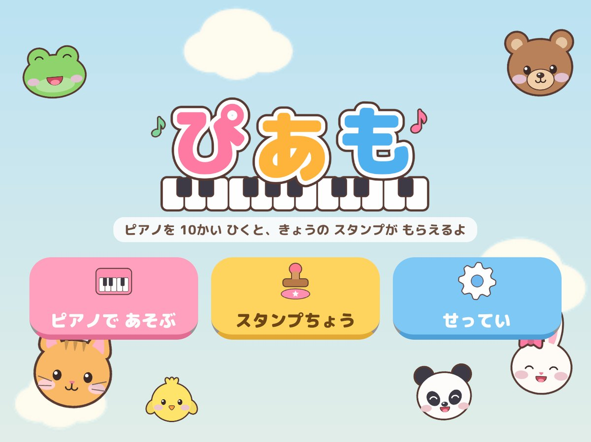
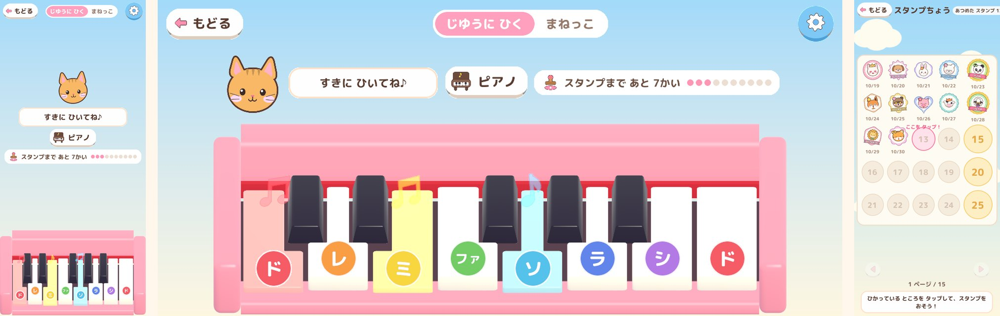
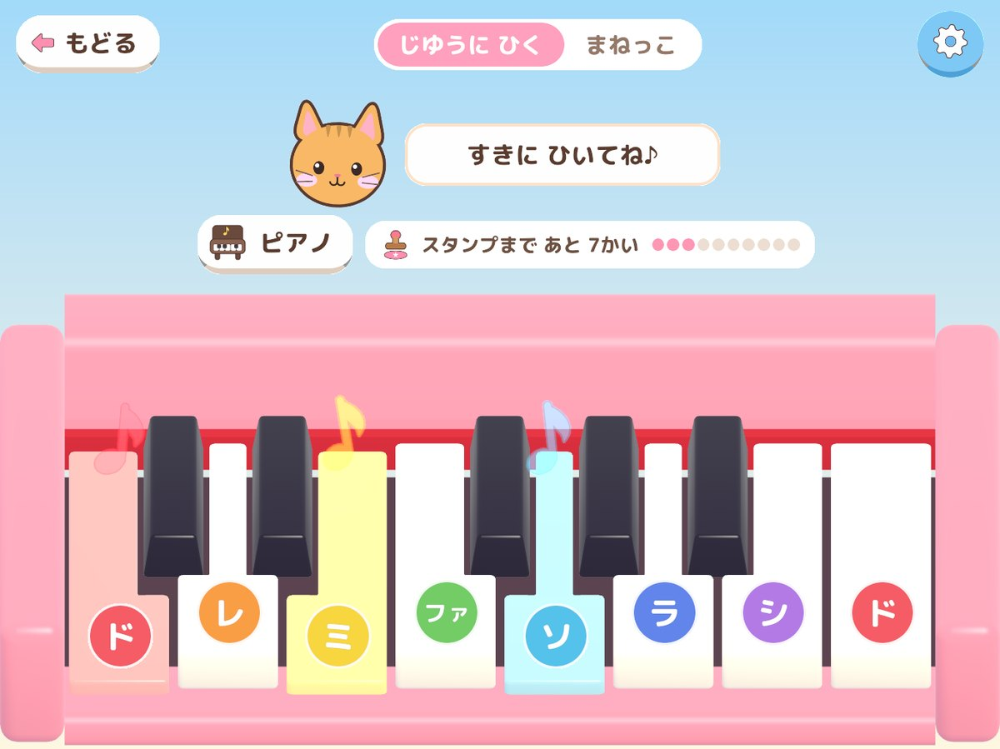
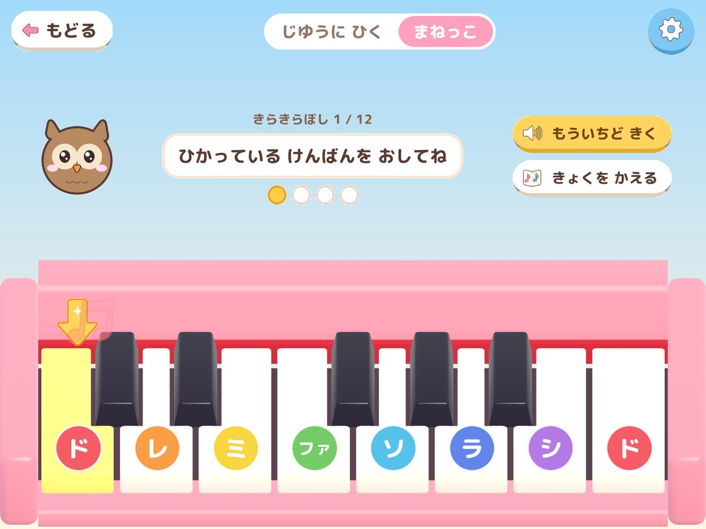
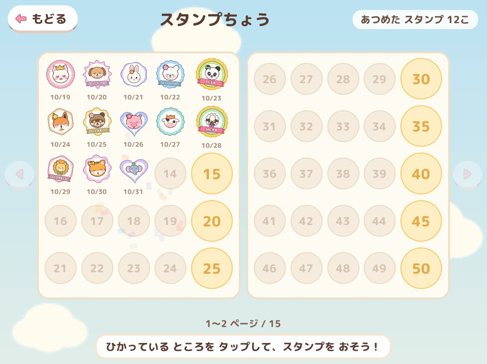
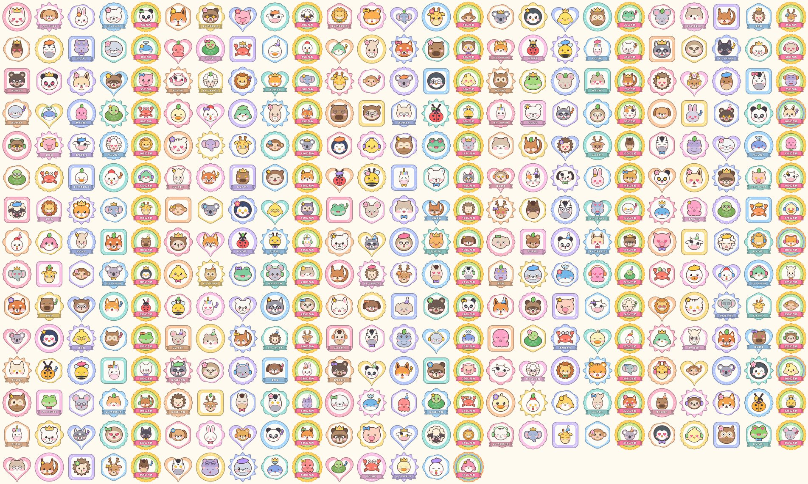
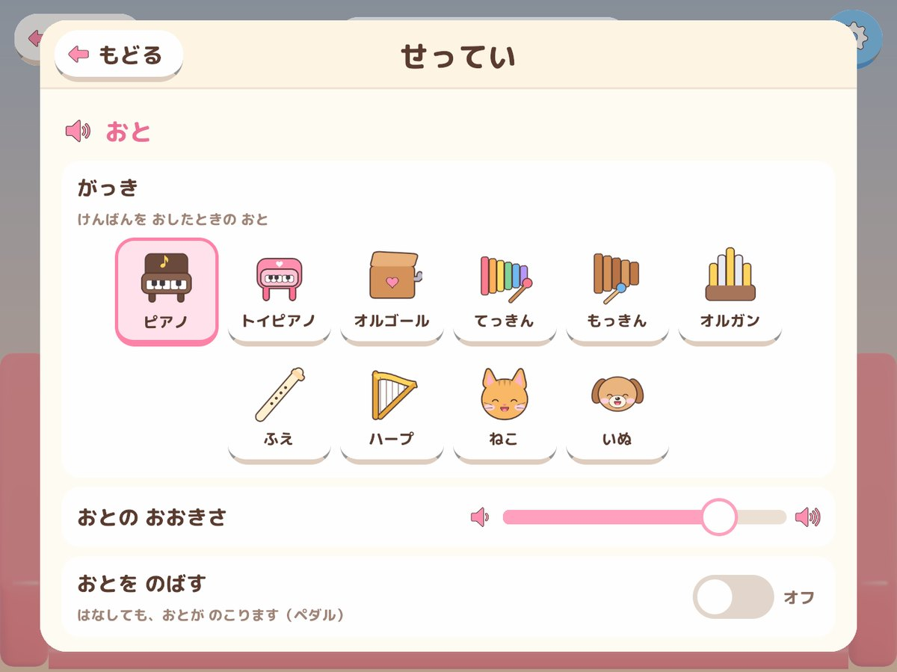

# ぴあも — Piamo

こどもむけの ピアノアプリです。じゆうに ひいたり、おてほんを **まねっこ** したり。
あそんだ日は、**どうぶつの スタンプ**（365 しゅるい）を 1 こ おせます。5 こめ・10 こめ… は **でっかい スタンプ** です。
PC・**スマホ／iPad** の ブラウザで あそべます（ホーム画面に追加すると、アプリのように全画面になります）。

**▶ あそぶ：<https://ksan260307.github.io/piamo/>**





## もくじ

- [あそびかた](#あそびかた)
- [せってい](#せってい)
- [開発](#開発)
- [クレジット](#クレジット)

## あそびかた

```
メニュー
 ├─ ピアノで あそぶ   … じゆうに ひく ／ まねっこ（せっていは この画面からも ひらける）
 ├─ スタンプちょう
 └─ せってい
```

どの画面にも **「もどる」**（メニューへ もどる）が あります。せっていを ピアノの とちゅうで ひらいたときは、「もどる」で ピアノへ もどります。

### ピアノで あそぶ



- はじめは いちばん少ない **ド〜ド（8 けん）** の けんばんです。せっていで 5 オクターブ（36 けん）まで ふやせます。
- 何本の ゆびでも いっしょに おせます（和音）。ゆびを すーっと すべらせると、となりの けんばんへ つづけて なります（グリッサンド）。
- けんばんの 上に ドレミの なまえ（いろつき）と、おした音の ♪ が とびだします。
- けんばんが 多くて 細くなりすぎるときは、上の 小さな けんばんの 帯で スクロールします。
- パソコンの キー：`A S D F G H J K L ; '` が 白い けんばん、`W E T Y U O P` が くろい けんばん（見えている いちばん左の ド から）。

### まねっこ



1. きょく（または れんしゅう）を えらぶ
2. **おてほん** が なる（けんばんも ひかる）
3. おなじ ように ひく。ちがう音を おしても、やりなおしには なりません
4. **10 びょう まよったら、こたえの けんばんが ひかります**（ヒント。じかんは せっていで かえられます）
5. ぜんぶ ひけたら はなまる！（ひけた きょくには ★）

| きょく | | きょく | |
| --- | --- | --- | --- |
| きらきらぼし | ふくろう | ロンドンばし | いぬ |
| かえるのうた | かえる | よろこびのうた | ライオン |
| メリーさんのひつじ | ひつじ | こげこげボート | あひる |
| つきのひかり | うさぎ | ジングルベル | ペンギン |
| ドレミファソ（れんしゅう） | ねこ | ドミソ（れんしゅう） | くま |
| おまかせ（毎回ちがう音。だんだん ながく） | パンダ | | |

どの きょくも 1 オクターブ（ド〜ド）の 白い けんばんだけで ひけます。メロディは どれも ちょさくけんの きれた むかしからの もの です。

### スタンプちょう



- その日に けんばんを **10 かい** おすと、**きょうの スタンプ** が もらえます（1 日に 1 こ）。
- スタンプは スタンプちょうで、ひかっている ところを **じぶんで タップして おします**。おしわすれても、あそんだ日の 分は のこります。
- **5 の倍数**（5・10・15…）は **でっかい スタンプ**（金の わく・「○にちめ」の リボン・ファンファーレ）。100・200・300・365 こめは にじいろ。
- スタンプの絵は **365 しゅるい**（47 しゅの どうぶつ × かお 11 しゅ × かざり 13 しゅ × わく 8 しゅ の 組み合わせ。ぜんぶ ちがう）。366 こめからは 2 さつめ。
- おした スタンプを タップすると、大きな絵・なまえ・おした日が 見られます。



## せってい



| ぶんるい | せってい | えらべるもの |
| --- | --- | --- |
| おと | がっき | ピアノ・トイピアノ・オルゴール・てっきん・もっきん・オルガン・ふえ・ハープ・ねこ・いぬ（ピアノの画面の がっきボタンからも かえられる） |
| | おとの おおきさ | スライダー |
| | おとを のばす | はなしても おとが のこる（ペダル） |
| けんばん | けんばんの かず | 8・15・22・29・36 けん（1〜5 オクターブ） |
| | オクターブ | おとの たかさを 1 オクターブずつ（C1〜C8 の はんいで） |
| | けんばんの おおきさ | ちいさい・ふつう・おおきい（細くなりすぎると スクロール） |
| | くろい けんばん | あり・なし（なしは しろい けんばんだけ） |
| | おんめい | なし・ドレミ・どれみ・CDE・いろ |
| | にじいろの けんばん | しろい けんばんを ドレミの いろに |
| | ピアノの いろ | 8 しょく |
| まねっこ | おてほんの はやさ | ゆっくり・ふつう・はやい |
| | まねする ながさ | みじかい（4 音まで）・ふつう（1 フレーズ）・ながい（2 フレーズ） |
| | ヒント | なし・5・10・15・20 びょう（はじめは 10 びょう） |
| | おてほんで ひかる | おてほんの とき けんばんも ひからせる |
| がめん | おんぷが とぶ・ボタンの おと・はいけい（そら・ゆうやけ・よる・もり） | |
| おうちの かたへ | せっていを もとに もどす・スタンプを ぜんぶ けす（2 びょう ながおし ＋ かくにん） | |

せっていと スタンプは、その たんまつの ブラウザに 保存されます。

## 開発

- **エンジン**: Unity 6 (6000.5.4f1) / URP / UI Toolkit / Input System
- **けんばん**: Blender 5.2 の Python スクリプトで プロシージャル生成（`blender/scripts/build_piano_kit.py`。白鍵は 黒鍵の切りかきの形 4 しゅ・黒鍵・ケース）
- **スタンプ・どうぶつ・アイコン**: Python（Pillow）で生成（`tools/make_stamps.py`・`tools/make_icons.py`）
- **音**: 10 の楽器（C1〜C8 を 4 半音おき）と 効果音を Python (numpy) で合成（`tools/make_audio.py`）
- **公開**: GitHub Actions → GitHub Pages（WebGL）

### フォルダ構成

```
blender/scripts/       Blender で けんばんを作るスクリプト（piano_kit.blend も出力）
blender/tests/         Blender のテスト
tools/                 スタンプ・アイコン・フォント・音の生成、ローカルビルドとテストのスクリプト
unity/                 Unity プロジェクト
  Assets/Art/Models    Blender から出力した FBX
  Assets/Audio         楽器（Instruments/<楽器>/）と効果音（Sfx/）
  Assets/Scripts       Core（鍵盤のならび・カメラ・保存・スタンプのきまり）/ Audio / Piano / Mimic / Stamps / UI
  Assets/Shaders       おもちゃのような光のシェーダー・はいけい
  Assets/UI            UI Toolkit (UXML/USS)・アイコン・どうぶつの絵・フォント
  Assets/StreamingAssets/Stamps   スタンプの絵 365 こ（見るときだけ読みこむ）
  Assets/Editor        プロジェクトの自動セットアップとビルド
  Assets/Tests         EditMode / PlayMode のテスト
docs/                  ビルド済み WebGL（GitHub Pages の公開用）
images/                README の絵
.github/workflows/     GitHub Pages への自動デプロイ
```

### アセットを作り直す

```powershell
& "C:\Program Files\Blender Foundation\Blender 5.2\blender.exe" -b --factory-startup --python blender/scripts/build_piano_kit.py
python tools/make_stamps.py   # スタンプ 365 こ・どうぶつの絵（tools/previews/stamps_sheet.png に一覧）
python tools/make_icons.py    # アイコン・ロゴ・アプリのアイコン・はいけい
python tools/make_fonts.py    # アプリの文字を ふやしたら、もう一度（M PLUS Rounded 1c を取ってきて小さくする）
python tools/make_audio.py    # python tools/make_audio.py piano で ピアノだけ、sfx で効果音だけ
```

### Unity で開く・ビルドする

- Unity Hub で `unity/` フォルダを開き、`Assets/Scenes/Main.unity` を再生します。
  メニュー **Piamo > Setup Project** で マテリアル・シーンを作り直せます。
- ローカルでビルドして `docs/` を更新：`powershell -ExecutionPolicy Bypass -File tools/build_webgl.ps1`
  （`-Assets` で けんばん・スタンプ・音などの生成から、`-Setup` で Unity のセットアップから やり直す）
- 画面の絵（スマホ よこ・たて、iPad よこ・たて）は PlayMode のテスト `ScreenshotTour`（指定したときだけ動く［Explicit］）で `build-tmp/screens/` に描き出せます：
  `Unity.exe -batchmode -projectPath unity -runTests -testPlatform PlayMode -testFilter Piamo.Tests.ScreenshotTour`

### テスト

```powershell
powershell -ExecutionPolicy Bypass -File tools/run_tests.ps1            # すべて
powershell -ExecutionPolicy Bypass -File tools/run_tests.ps1 -Only PlayMode
```

| 種類 | 件数 | 場所 |
| --- | ---: | --- |
| Unity EditMode（単体） | 67 | `unity/Assets/Tests/EditMode` |
| Unity PlayMode（総合） | 22（画面の絵を描き出す 1 件は、指定したときだけ） | `unity/Assets/Tests/PlayMode` |
| Blender（単体） | 8 | `blender/tests` |
| Python（単体） | 22 | `tools/tests` |

テストの中身は [TESTING.md](TESTING.md) へ。

### 公開（CI/CD）

`main` に push すると `.github/workflows/deploy-pages.yml` が動き、GitHub Pages に公開されます（しゃくとりの森と同じ しくみ）。

1. リポジトリ設定 **Settings → Pages → Build and deployment → Source** を **GitHub Actions** にする（初回のみ）
2. そのままでも、リポジトリに入っている ビルド済みの `docs/` が公開されます（Python の テストと、ビルドの検査 `tools/check_build.py` は 毎回）
3. GitHub Actions 上で Unity から テスト・ビルドしたい場合は、**Settings → Secrets and variables → Actions** に次を登録します
   - `UNITY_LICENSE` … Unity Hub でライセンスを有効化したときにできる `Unity_lic.ulf` の中身（Windows: `C:\ProgramData\Unity\Unity_lic.ulf`）
   - `UNITY_EMAIL` / `UNITY_PASSWORD` … Unity アカウント（Pro ライセンスの場合は `UNITY_SERIAL` も）

   登録すると、push のたびに [game-ci](https://game.ci/) で EditMode・PlayMode のテストをして、WebGL をビルドして公開します。
4. ワークフローの権限は、ふだんは読むだけ（`contents: read`）。公開のジョブだけが `pages: write` / `id-token: write`、Unity のテストのジョブだけが `checks: write` を持ちます。

## クレジット

- フォント：[M PLUS Rounded 1c](https://fonts.google.com/specimen/M+PLUS+Rounded+1c)（Copyright 2016 The Rounded M+ Project Authors. SIL Open Font License 1.1）。アプリで使う文字だけに小さくして同梱
- まねっこの メロディ：きらきらぼし（フランス民謡）・かえるのうた（ドイツ民謡）・メリーさんのひつじ（アメリカ民謡）・つきのひかり（フランス民謡）・ロンドンばし（イギリス民謡）・よろこびのうた（ベートーヴェン）・こげこげボート（アメリカ民謡）・ジングルベル（J. ピアポント）。どれも ちょさくけんの きれた メロディ
- けんばんの 形・スタンプ・どうぶつ・アイコン・音は、すべて この アプリの ために プログラムで つくりました
